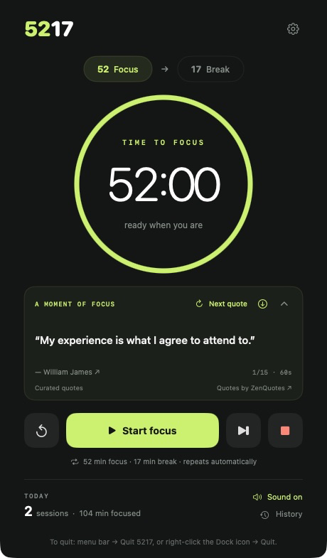
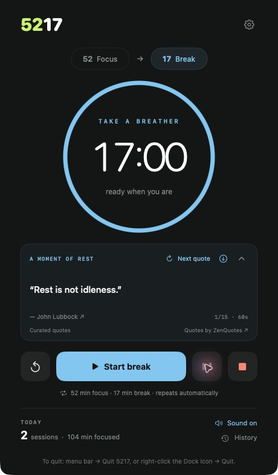
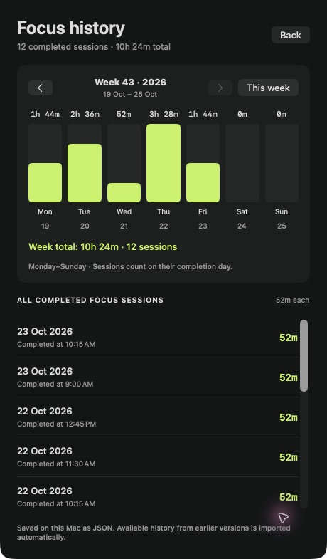
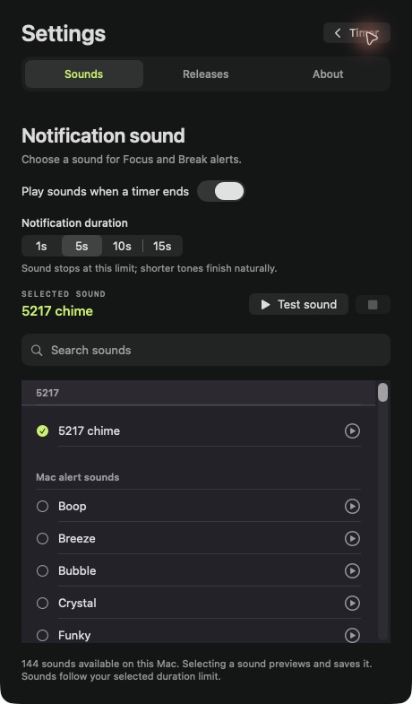
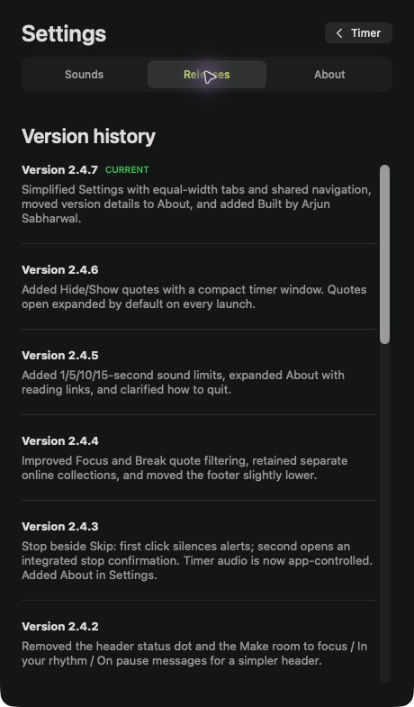
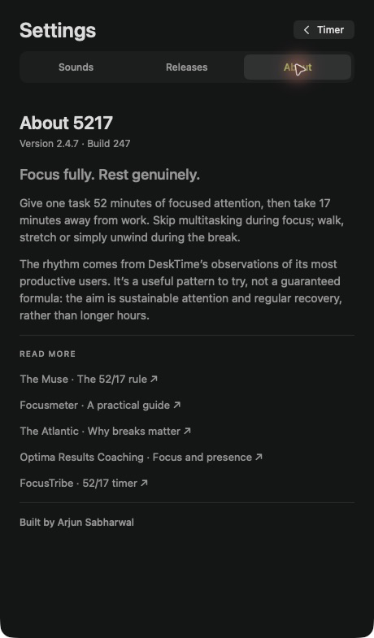

# 5217

A native macOS focus timer. Focus for 52 minutes,
then take a 17-minute break. Current app version: **2.4.7**.

## Screenshots

Focus and Rest keep the countdown front and center. History shows completed focus
sessions, while Settings separates sound controls, release notes and About.
History and session totals below use illustrative sample data, not personal records.

| Focus | Rest |
| --- | --- |
|  |  |

| Focus history | Settings · Sounds |
| --- | --- |
|  |  |

| Settings · Releases | Settings · About |
| --- | --- |
|  |  |

## Features

- Seconds countdown, pause, resume, reset and skip, with menu-bar controls.
- Completion alerts, selectable local sounds and 1, 5, 10 or 15-second sound limits.
- Completed focus-session history and a Monday–Sunday chart in hours and minutes.
- Motivational Focus quotes and calming Break quotes, with offline fallbacks.
- Collapsible quotes and integrated Settings, History and stop confirmation.
- Local JSON storage; no database or account required.

## Requirements and installation

**Apple silicon Mac · macOS 13 or later. Intel Macs are not supported.**

Download the Apple Silicon DMG from this repository’s **Releases** page when a
release has been published. Open it and drag 5217 into Applications.
The current build uses an ad-hoc signature and is not Apple-notarized, so macOS
may require approval in Privacy & Security. See [installation notes](Install%205217.txt).

## Build from source

Install Apple’s Command Line Tools (`xcode-select --install`) and Python 3.
From the repository directory, run:

```sh
bash build.sh
```

This compiles the ARM64 app, signs it locally, runs the automated checks and
creates `dist/5217-v2.4.7-Apple-Silicon.dmg`.
Build tools are `swiftc`, `codesign`, `hdiutil` and Python 3; there are no third-party
package dependencies. Normal macOS audio-service access is required by sound checks.
The project builds directly with Swift CLI tools; no Xcode project is included.

For checks without creating an installer:

```sh
bash scripts/test.sh
```

The release passed 164 automated checks. Physical validation was performed on
macOS 27; earlier supported versions have not been tested on physical machines.
Alerts cannot be guaranteed during manual sleep or while the Mac is powered off.

## Releases

v2.4.7 Avaiable for download : [https://github.com/infomedia0/5217/releases/tag/release](v2.4.7)


## Privacy and quote attribution

Timer state and focus history remain in `~/Library/Application Support/5217/`.
Sound previews can create local `5217-*.caf` files in `~/Library/Sounds/`.

The app fetches quote batches from [ZenQuotes](https://zenquotes.io/), with caching
and request cooldowns. It sends no session history or timer state. The provider
receives normal network metadata, including the IP address and app User-Agent.
Online quote classification is conservative keyword matching, not AI.
[Offline quote sources](Quotes.md) and [third-party notices](THIRD_PARTY_NOTICES.md)
describe content attribution. Apple system sounds are discovered locally and are
not redistributed.

## Contributing and license

See [CONTRIBUTING.md](CONTRIBUTING.md) for development guidance,
[CHANGELOG.md](CHANGELOG.md) for release history, and
[docs/DEVELOPMENT.md](docs/DEVELOPMENT.md) for detailed implementation notes.

Project code is available under the [MIT License](LICENSE).
Third-party quotations and services retain their own rights
and terms; see the notices above.
